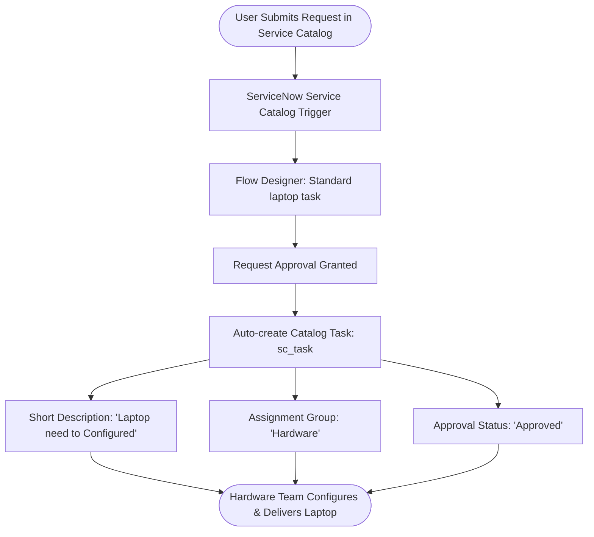

# ServiceNow Automated Laptop Fulfillment Workflow

## 1. Executive Summary & Objective

By automating the standard laptop procurement process with ServiceNow's **Flow Designer**, this project eliminates manual task creation, reduces administrative overhead, and accelerates delivery cycles. 

The automated workflow triggers upon catalog item ordering, automatically generates a targeted fulfillment task assigned to the Hardware team, and pre-populates critical tracking attributes. This ensures timely laptop configuration, minimizes employee downtime, and significantly enhances both IT operational efficiency and end-user satisfaction.

---

## 2. Architecture & Workflow Design

---

## 3. Implementation Modules

### Module 1: Flow Creation & Configuration (Flow Designer)

1. **Navigation:** Navigate to **All** &rarr; Search for **Flow Designer** &rarr; Select **Flow Designer** under *Process Automation*.
2. **Create Flow:** Click **New** &rarr; Select **Flow**.
3. **Flow Properties:**
   - **Flow Name:** `Standard laptop task`
   - **Application:** `Global`
   - **Run As:** `System User`
   - Click **Submit**.
4. **Define Trigger:**
   - Click **Add a trigger**.
   - Search and select **Service Catalog**.
   - Click **Done**.
5. **Configure Actions:**
   - Under Actions, click **Add an Action**.
   - Select **ServiceNow Core** &rarr; **Create Catalog Task**.
   - Set the following parameters:
     - **Requested Item:** Drag and drop the `Requested Item Record` from the Data pill picker.
     - **Table:** Auto-populates as `Catalog Task` (`sc_task`).
     - **Short Description:** `Laptop need to Configured`
     - Click **Add field value**:
       - **Description:** `Laptop need to Configured`
       - **Assignment Group:** `Hardware`
       - **Approval:** `Approved`
     - Keep remaining fields as default and click **Done**.
6. **Save & Activate:** Click **Save**, then click **Activate** and confirm activation.

#### Milestone 1 Evidence:

*Figure 1.1: Flow Designer setup with Service Catalog trigger and Create Catalog Task action.*

.jpeg)

*Figure 1.2: Detailed configuration and field mapping for the Catalog Task.*

---

### Module 2: Catalog Item Association (Maintain Items)

1. **Navigation:** Navigate to **All** &rarr; Search for **Maintain Items**.
2. **Locate Item:** In the Item list, search for name `Standard Laptop` and open the record.
3. **Process Engine Configuration:**
   - Navigate to the **Process Engine** tab/section.
   - Remove any legacy workflow or execution plan associations.
   - Under **Flow**, search and select the newly activated flow: `Standard laptop task`.
   - Click **Update** / Save from the form context menu to persist changes.

#### Milestone 2 Evidence:

*Figure 2.1: Maintain Items view for Standard Laptop.*

.jpeg)

*Figure 2.2: Standard Laptop record mapped to the 'Standard laptop task' Flow.*

---

### Module 3: Request Submission & End-to-End Verification

1. **Place Request:**
   - Navigate to **All** &rarr; Search for **Service Catalog**.
   - Select **Hardware** category &rarr; Choose **Standard Laptop**.
   - Review item options and click **Order Now**.
2. **Order Confirmation & Request (REQ):**
   - Click on the generated **Request Number** (`REQXXXXXXX`).
   - Scroll to the **Approvers** related list.
   - Right-click the approval record and select **Approve** (or update state to Approved).
3. **Requested Item (RITM) & Task (SCTASK) Verification:**
   - Navigate to the **Requested Items** related list and open the `RITM` record.
   - Scroll down to the **Catalog Tasks** section.
   - Verify that a new `SCTASK` has been automatically generated by the flow:
     - **Short Description:** `Laptop need to Configured`
     - **Assignment Group:** `Hardware`
     - **Approval:** `Approved`
     - **State:** `Open` / ready for technician handling.

#### Milestone 3 Evidence:

*Figure 3.1: Service Catalog Standard Laptop selection and order submission.*

.jpeg)

*Figure 3.2: Verification of automatically created Catalog Task under the RITM.*

---

## 4. Key Benefits & Results

- **Zero-Touch Task Generation:** Eliminates manual dispatching and administrative overhead upon ordering.
- **SLA Reduction:** Tasks are assigned instantly to the **Hardware** group upon order approval, cutting turnaround time.
- **Data Standardization:** Automatic population of task details avoids typographical and procedural inconsistencies.
- **Enhanced Visibility:** Real-time progress tracking across REQ, RITM, and SCTASK levels for both requesters and fulfillment staff.
